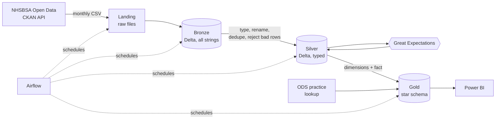

# NHS Prescribing Lakehouse

A small data platform I built around the NHSBSA **English Prescribing Dataset (EPD)**: every
prescription item dispensed in England, by GP practice and drug, every month. It's open data,
and it's big enough (around 17 million rows a month, so roughly 200 million a year) that you
have to think about how you load it rather than just throwing it into pandas.

The pipeline follows the usual bronze → silver → gold pattern on Delta Lake, with PySpark doing
the work, Great Expectations checking the data, Airflow scheduling it and GitHub Actions
testing every push. It runs on a laptop in Docker, and there's a Bicep template if you want it on Azure.

## Architecture



| Layer | What's in it | Why |
|-------|--------------|-----|
| **Landing** | The CSV exactly as NHSBSA publish it | So I can always replay from the original |
| **Bronze** | Same data as Delta, every column a string, plus `_source_file` and `_ingested_at` | Nothing is lost if the source sends something odd |
| **Silver** | Typed columns, one schema across all months, bad rows moved to `epd_rejects` with a reason | The first layer you'd trust to query |
| **Gold** | Star schema + two pre-aggregated tables | Fast, simple tables for BI |

### Gold star schema

```
                dim_date
                   |
dim_practice --- fact_prescribing --- dim_drug
                   |
                dim_icb
```

`fact_prescribing` is one row per practice, drug and month, with `items`, `quantity`, `nic` and
`actual_cost`. `dim_date` carries the NHS financial year (April to March). `dim_drug` includes the BNF
chapter name, so you can slice spend by therapeutic area without a separate lookup.
`agg_icb_chapter_month` and `agg_practice_month` exist because dashboards shouldn't
have to scan the fact table for the common views.

## A few decisions worth explaining

- **Each month is its own Delta partition and gets replaced, not appended.** Re-running
  January leaves you with one January. That's what makes retries in Airflow safe.
- **Schema drift is handled in silver, not by hand.** Sub-ICB/ICB columns were called `STP_*`
  before July 2022. Silver coalesces both, so older and newer months land in the same table.
- **Rejects are kept, not dropped.** A row with a malformed practice or BNF code goes to
  `silver/epd_rejects` with a reason. If more than 1% of a month is rejected, the run fails
  loudly rather than quietly publishing a thin month.
- **EPD isn't unique on practice + drug.** The same drug can appear several times for a
  practice (different pack sizes), so silver only removes *exact* duplicates and gold sums the rest.
- **Gold is rebuilt in full each run.** The dimensions need "latest known details" and the
  aggregation is cheap next to reading the data, so a full rebuild is simpler and less likely to be wrong than merge logic.

## Run it

### Locally (Python 3.10–3.12 and Java 17)

```bash
pip install -e ".[dev]"
pytest                          # unit tests; Spark tests run if Java is installed

rxlake list-months              # what NHSBSA have published
rxlake run 2024-01              # download + bronze + silver + gold for one month
```

Output goes to `./lake/{bronze,silver,gold}`. A single month is a ~6 GB download, so give it
disk space and a few minutes. Give Spark more memory with `SPARK_DRIVER_MEMORY=8g`.

### Docker (no Java install needed)

```bash
docker compose build
docker compose run --rm rxlake run 2024-01
docker compose up airflow       # http://localhost:8080  (admin / admin)
```

Data is written to `./data`, which is git-ignored.

### Optional: practice lookup

Download `epraccur` from the [NHS ODS data](https://digital.nhs.uk/services/organisation-data-service/export-data-files/csv-downloads/gp-and-gp-practice-related-data)
to `landing/lookups/epraccur.csv` and `dim_practice` gains status, setting and open/close dates.

### Azure

```bash
az group create -n rg-rxlake -l uksouth
az deployment group create -g rg-rxlake -f infra/bicep/main.bicep -p prefix=rxlake
```

This creates an ADLS Gen2 account (`landing` and `lake` containers) and a Databricks workspace.
Set `RXLAKE_LAKE_ROOT` to the `lakeRoot` output and the same code runs unchanged.

## Data quality

Great Expectations runs inside the pipeline, on Spark DataFrames directly:

- **Silver** (every month): row count, non-null keys, practice and BNF code formats, non-negative
  items and quantity, plausible `year_month`.
- **Gold**: the fact table's keys are non-null, and every `practice_key` and `drug_key` has a row
  in its dimension (no orphans).

By default a failure stops the run (`quality.fail_on_error` in `conf/pipeline.yaml`).

## CI

`.github/workflows/ci.yml` runs on every push: ruff, pytest (including an end-to-end bronze → gold
test on a small made-up file, using real Spark and Delta), a Bicep build, and a Docker build.

## Power BI

See [powerbi/README.md](powerbi/README.md) for the model, relationships, DAX measures and page layout.
The `.pbix` file isn't in the repo.

## Honest status and what I'd improve

What's there is tested on a small sample file, not on a full year of production data. Specifically:

- I haven't run a full 12 months end to end, so there are no benchmark numbers here yet.
- The Power BI report itself isn't included, only the spec to build it.
- The Docker/Airflow compose file is a convenient demo setup (SQLite, one container), not production.

Next things I'd do:

1. Load only new months incrementally into gold with `MERGE`, once a full rebuild gets slow.
2. Add a freshness check and Slack/Teams alert when a month hasn't appeared by the 20th.
3. Join prescribing to list sizes (patients per practice) to give cost per head, which is the number analysts actually want.
4. Use Delta `OPTIMIZE` / Z-ORDER on `practice_key` for the big fact table.
5. Move Great Expectations results into a data-docs site published from CI.

## Data and licence

EPD is published by NHS Business Services Authority under the
[Open Government Licence](https://www.nationalarchives.gov.uk/doc/open-government-licence/version/3/).
This repo's code is MIT.
